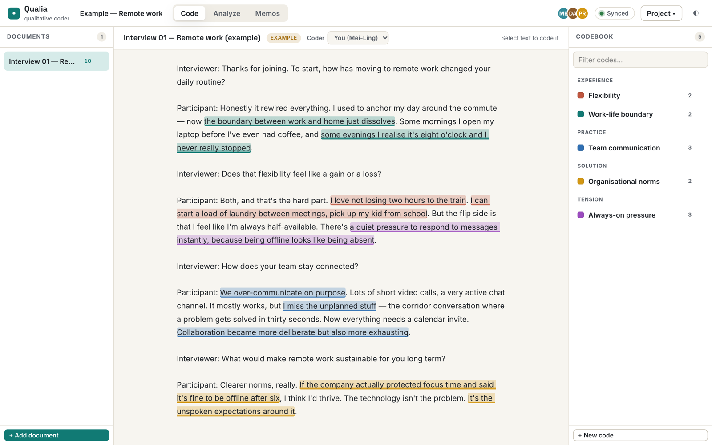
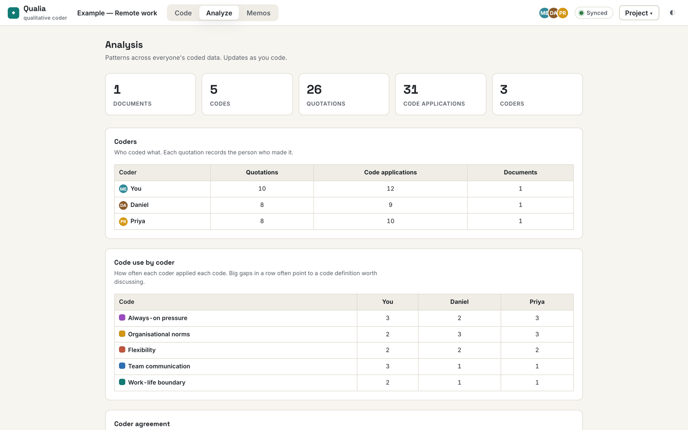
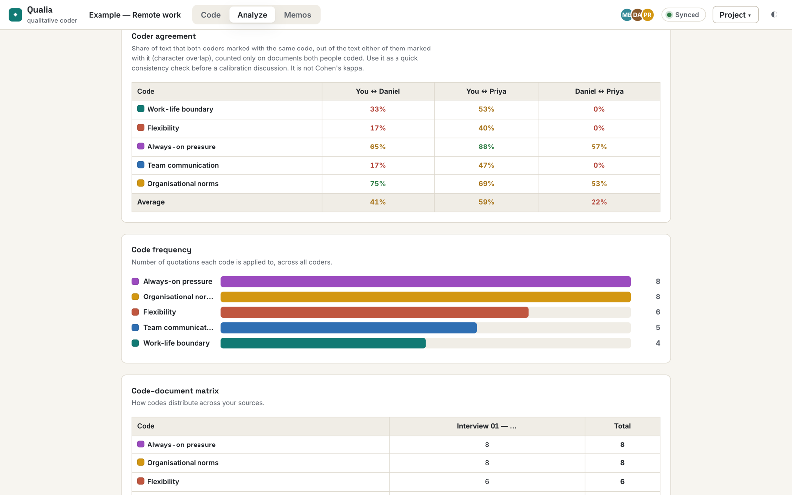
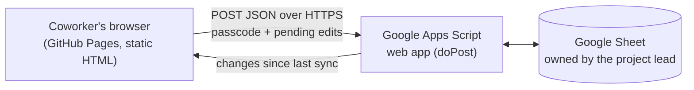

<div align="center">

# Qualia Coder

**Collaborative qualitative coding for small research teams: free, open source, one link.**

[](https://github.com/Matrttie/qualia-coder/actions/workflows/test.yml)


[**Try the demo →**](https://matrttie.github.io/qualia-coder/demo/) &nbsp;·&nbsp; [Set up your team](docs/SETUP.md) &nbsp;·&nbsp; [How it works](#how-it-works)



</div>

## Why

Commercial qualitative-analysis suites often cost hundreds of dollars per seat, and their team features usually cost more again. A three-person research team that only needs to **code interview transcripts together and compare their coding** shouldn't have to buy three licences or email project files back and forth.

Qualia Coder covers that core workflow. Coworkers open one link in a browser, type their name, and start coding. They don't need an account or an install. The data lives in a Google Sheet that the project owner controls.

## Features

- **Code transcripts.** Select any passage to tag it with one or more codes, then add comments and memos.
- **Codebook.** Codes have colours, groups and written definitions, and the whole team shares one codebook.
- **Real-time-ish collaboration.** Every edit syncs to the team within about 4 seconds, and each quotation records who coded it.
- **Code on your own.** Switch the codebook to **Mine** to hide teammates' codes and highlights while you do your own thematic analysis, or pick one person to see only their codes. Switch back to **All** to compare.
- **Coder comparison.** See code use by coder, and pairwise **inter-coder agreement**: character-overlap per code, ready for a calibration meeting.
- **Analysis.** Code frequency, a code × document matrix and code co-occurrence.
- **Export.** Download the whole project as JSON, or the quotations as CSV (with a coder column) for R, SPSS or Excel.
- **Private by default.** The team passcode is checked on the server, the data stays in the owner's Google Drive, and the page itself is static.

<table>
<tr>
<td width="50%"></td>
<td width="50%"></td>
</tr>
<tr>
<td align="center"><sub>Who coded what, and how each coder used each code</sub></td>
<td align="center"><sub>Pairwise agreement per code, plus code frequency</sub></td>
</tr>
</table>

<sub>Screenshots use the built-in fictional example interview and fictional coders.</sub>

## How it works



- **Frontend.** One self-contained HTML file with vanilla JavaScript and no framework or build step. It's served free from GitHub Pages.
- **Backend.** A ~150-line Google Apps Script (`apps-script/Code.gs`) deployed as a web app. It also runs free on the owner's Google account.
- **Sync protocol.** One endpoint both applies a batch of writes and returns every record changed since the client's last server stamp.
  - Stamps are monotonic, so no update is skipped even if Google's servers disagree on the time.
  - Deletes are stored as tombstones.
  - A `LockService` lock serialises writers.
- **Optimistic UI.** Edits show instantly from a local pending-write queue and are retried until the server confirms them.
- **Storage.** Each record (document, code, quotation, memo) is one row of JSON. Long transcripts are split into 20,000-character chunks to stay under the 50,000-character cell limit.
- **No Google sign-in needed.** The page sends cookie-less `text/plain` requests. That avoids a CORS preflight and the multi-account bug that breaks many Apps Script web apps.

## Quick start

**Just looking?** Open the [demo](https://matrttie.github.io/qualia-coder/demo/). It runs entirely in your browser with an example interview, and nothing is uploaded.

**Running it for your team** takes about 10 minutes, with no server and no cost:

1. Create a Google Sheet, open **Extensions → Apps Script**, and paste in [`apps-script/Code.gs`](apps-script/Code.gs). Add an HTML file named `Index` containing [`apps-script/Index.html`](apps-script/Index.html).
2. Set a long `PASSCODE` at the top of `Code.gs`.
3. **Deploy → Web app**, with *Execute as: Me* and *Who has access: Anyone*. Copy the `/exec` URL.
4. Fork this repo, run `node scripts/build-pages.js <your /exec URL>`, commit `index.html`, and turn on GitHub Pages.

Full walkthrough: [docs/SETUP.md](docs/SETUP.md).

## Security model

| | |
|---|---|
| **Where data lives** | Only in the project owner's Google Sheet. This repository contains no research data. |
| **Who can read or write** | Anyone with the link **and** the team passcode. The passcode is checked server-side in Apps Script and never appears in this repo. |
| **Transport** | HTTPS only. Requests carry no cookies or Google credentials. |
| **Limits** | One shared passcode, not per-person accounts. Editing other coders' quotations is blocked in the UI, but this is not cryptographic access control. It's built for small teams that trust each other. |

For sensitive data, de-identify transcripts before uploading, and check your ethics board's (IRB) requirements.

## Development

```bash
npm test          # backend test suite: sync, tombstones, clock skew, size limits, passcode, doPost
npm run build -- https://script.google.com/macros/s/<DEPLOYMENT_ID>/exec
```

```
apps-script/
  Code.gs        backend: storage, sync API, passcode check
  Index.html     the whole app (also served directly by Apps Script)
scripts/
  build-pages.js makes the GitHub Pages copy pointing at your backend
tests/
  backend.test.js runs Code.gs against an in-memory fake of SpreadsheetApp
demo/            browser-only demo (no backend)
index.html       generated team app (do not edit by hand)
```

## Built with AI

I designed and built this with [Claude Code](https://claude.com/claude-code) as a pair programmer. I wrote the product requirements, made the architecture and security decisions, and drove the testing. Claude wrote most of the code under that direction. The commit history is the honest record.

## Team

| | |
|---|---|
| [**Chingwei Chen**](https://github.com/Matrttie) | Project lead: product, architecture, testing |
| [**morristan10**](https://github.com/morristan10) | Collaborator |

## Licence

[MIT](LICENSE) © 2026 Chingwei Chen
